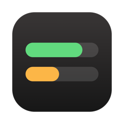

<p align="center">
  
</p>

<h1 align="center">Claude Usage Bar</h1>

<p align="center">
  <b>See how much of your Claude limits you have left.</b><br>
  Your 5-hour and weekly usage, for every Claude account you use,<br>
  right in the Mac menu bar.
</p>

<p align="center">
  <a href="https://github.com/jiachengw-sf/claude-usage-menubar/releases/latest">⬇️ <b>Download</b></a> ·
  <a href="#features">Features</a> ·
  <a href="#getting-started">Getting started</a> ·
  <a href="#build-from-source">Build from source</a> ·
  <a href="#how-it-works">How it works</a>
</p>

<p align="center">
  <a href="https://github.com/jiachengw-sf/claude-usage-menubar/releases/latest"></a>
  
  
  
</p>

<hr>

> [!WARNING]
> **Unsigned build.** Claude Usage Bar isn't signed with an Apple Developer ID or notarized, so macOS blocks the first launch. Right-click the app and choose **Open**, or allow it under *System Settings › Privacy & Security*.

> [!NOTE]
> This is an unofficial tool, not affiliated with Anthropic. It reads the same usage numbers as Claude Code's `/usage`, from endpoints that aren't publicly documented and may change.

## Features

- **Live limits in the menu bar.** Session (5-hour) and weekly limits, colored green / orange / red as they run down. Refreshes every 5 minutes and right after your Mac wakes.
- **Multiple accounts.** Sign in with as many Claude accounts as you like (personal, work, school) and see them side by side. Give each one a short name.
- **Stays signed in.** The app keeps its own login for each account and renews it, so it keeps working through restarts, sleep, and Claude Code logouts. Already use Claude Code? Its logins are picked up automatically.
- **Four menu bar styles.** Names and percentages, initials only (`P 82%  W 96%`), a single icon for the account with the least left, or one account's session + week side by side.
- **Weekly reports.** When an account's weekly limit resets you get a notification and an HTML report: how much you used vs. last week, every 5-hour session (and which ones hit the limit), Claude Code activity by day, project and model, and an estimate of how much went to chat or Cowork.
- **Starts with your Mac**, keeps only the last 4 weeks of reports, and can stand in for the Claude app's own menu bar icon (**Open Claude**, ⌘O).

## Getting started

1. [Download the latest release](https://github.com/jiachengw-sf/claude-usage-menubar/releases/latest), unzip it, and move **ClaudeUsageBar.app** to your Applications folder.
2. Open it (right-click → **Open** the first time, see the warning above).
3. In the welcome window, click **Sign in with Claude** and approve in your browser.
4. To add another account, click **Add Another Account**. Sign out of claude.ai in your browser first, or it will sign you into the same account again.

You can get back to this window any time from the menu bar: **Accounts › Manage Accounts…** (⌘,).

## Build from source

Requires macOS 13+ and the Xcode command line tools (`xcode-select --install`).

```bash
git clone https://github.com/jiachengw-sf/claude-usage-menubar.git
cd claude-usage-menubar
./build.sh
open /Applications/ClaudeUsageBar.app
```

`build.sh` compiles a universal (Apple silicon + Intel) app, signs it ad hoc, and installs it to `/Applications`. `./build.sh --zip` also makes the zip used for releases.

## How it works

- **Limits** come from `api.anthropic.com/api/oauth/usage`, the endpoint behind Claude Code's `/usage`. If Anthropic asks the app to slow down, it backs off and keeps showing the last numbers.
- **Sign-in** uses the same OAuth flow as Claude Code (PKCE, with a one-time localhost redirect). Tokens are stored in your login Keychain under `ClaudeUsageBar-login` and are only ever sent to Anthropic.
- **Report breakdowns** read Claude Code's local session files (`~/.claude*/projects`). Chat and Cowork don't save usage on your Mac, so their share is estimated from the limit used beyond your Claude Code work, calibrated on your own history.
- **Your data** stays on your Mac: reports in `~/Library/Application Support/ClaudeUsageBar/Reports`, a status log in `~/Library/Logs/ClaudeUsageBar.log`. Anything older than 4 weeks is deleted automatically.

"API-equivalent cost" figures in reports use public list prices for comparison only. On a subscription you aren't charged per token.
